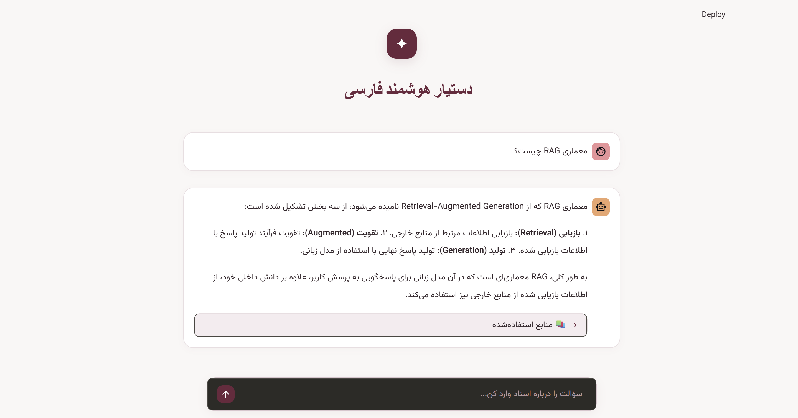
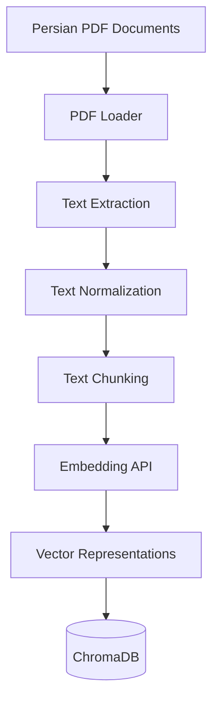
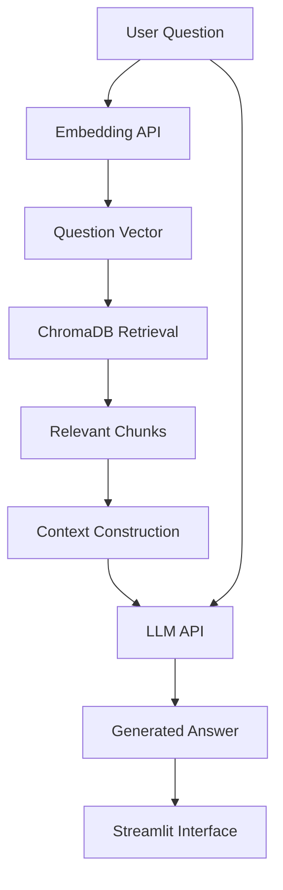

# Persian RAG | Persian Document Question Answering System

<p align="center">
  <strong>A Retrieval-Augmented Generation application for querying Persian PDF documents.</strong>
</p>

<p align="center">
  
  
  
  
  
</p>

---

## Overview

**Persian RAG** is a Retrieval-Augmented Generation (RAG) application that allows users to ask questions about Persian PDF documents and receive context-aware answers based on their contents.

Instead of relying solely on the language model's internal knowledge, the application retrieves relevant information from the provided documents and uses it as context to generate more relevant and source-grounded responses.

The system integrates an external embedding API, an OpenAI-compatible Large Language Model (LLM), and ChromaDB as its vector database.

## Application Preview

<p align="center">
  
</p>

## Key Features

- **Persian PDF Processing:** Extracts text and metadata from Persian PDF documents.
- **Text Normalization:** Normalizes Persian characters, digits, punctuation, and whitespace.
- **Text Chunking:** Splits documents into smaller, overlapping chunks.
- **API-based Embeddings:** Converts text chunks into vector representations using an external embedding service.
- **Vector Storage:** Stores embeddings, text chunks, and metadata in ChromaDB.
- **Semantic Retrieval:** Retrieves relevant document chunks based on the user's question.
- **Context-aware Generation:** Generates answers using retrieved document content and an LLM.
- **Source Tracking:** Preserves document names and page numbers for retrieved information.
- **Interactive Interface:** Provides a Persian-friendly user interface using Streamlit.
- **Docker Support:** Simplifies deployment and execution using Docker Compose.

## Architecture

The application consists of two main workflows: document ingestion and question answering.

### 1. Document Ingestion Pipeline

PDF documents are processed, converted into vector representations, and stored in ChromaDB.



### 2. Question Answering Pipeline

When a user submits a question, the system retrieves relevant chunks and sends them to the LLM along with the original question.



## Technology Stack

| Technology | Purpose |
|---|---|
| Python 3.14 | Core programming language |
| pypdf | PDF text extraction |
| Piraye | Persian text normalization |
| LangChain Text Splitters | Recursive text chunking |
| OpenAI Python SDK | Communication with the LLM API |
| ChromaDB | Vector database and similarity search |
| Streamlit | Interactive user interface |
| Docker | Application containerization |
| Docker Compose | Application deployment and configuration |

## Project Structure

```text
Persian_RAG/
│
├── data/
│   └── pdfs/                  # Input Persian PDF documents
│
├── docs/
│   └── persian-rag-ui.png     # Application screenshot
│
├── src/
│   ├── __init__.py
│   ├── app.py                 # Streamlit application
│   ├── main.py                # Main RAG pipeline
│   ├── pdf_loader.py          # PDF loading and text extraction
│   ├── text_normalizer.py     # Persian text normalization
│   ├── chunker.py             # Text splitting and metadata handling
│   ├── embedding.py           # Embedding API integration
│   ├── vector_store.py        # ChromaDB operations
│   └── retriever.py           # Relevant chunk retrieval
│
├── .dockerignore
├── .env.example
├── .gitignore
├── Dockerfile
├── docker-compose.yml
├── requirements.txt
└── README.md
```

## How It Works

### Document Ingestion

1. PDF files are loaded from the `data/pdfs/` directory.
2. Text is extracted page by page using pypdf.
3. Metadata such as filename and page number is preserved.
4. Extracted text is normalized to improve Persian text consistency.
5. Documents are divided into smaller, overlapping chunks.
6. Each chunk is sent to the embedding API to obtain its vector representation.
7. Embeddings, text chunks, and associated metadata are stored in ChromaDB.

### Question Answering

1. The user submits a question through the Streamlit interface.
2. The question is converted into an embedding using the embedding API.
3. ChromaDB searches for semantically similar document chunks.
4. Retrieved chunks are assembled into a context.
5. The original question and retrieved context are sent to the LLM.
6. The LLM generates a context-aware answer.
7. The answer and available source information are displayed in the Streamlit interface.

## Installation and Setup

### Prerequisites

- Python 3.14
- Git
- Access to the required LLM and embedding APIs
- Docker Desktop (for Docker deployment)

### 1. Clone the Repository

```bash
git clone https://github.com/ftm-hoseini/Persian_RAG.git
cd Persian_RAG
```

### 2. Create a Virtual Environment

```bash
python -m venv venv
```

Activate the virtual environment:

**Windows:**

```bash
venv\Scripts\activate
```

**Linux / macOS:**

```bash
source venv/bin/activate
```

### 3. Install Dependencies

```bash
pip install -r requirements.txt
```

### 4. Configure Environment Variables

Create a `.env` file in the project root based on `.env.example`.

```env
# LLM Configuration
LLM_API_KEY=your_llm_api_key
LLM_BASE_URL=your_llm_base_url
LLM_MODEL=your_llm_model

# Embedding Configuration
EMBEDDING_API_URL=your_embedding_api_url
```

Replace the placeholder values with your actual API configuration.

**Important:** Never commit your `.env` file or expose API keys in the repository.

### 5. Add PDF Documents

Place your Persian PDF files inside:

```text
data/pdfs/
```

The PDF files should contain extractable text. Scanned documents may require OCR before processing.

### 6. Ingest Documents

Run the ingestion pipeline from the project root:

```bash
python -c "from src.main import ingest_documents; ingest_documents()"
```

This command:

- Loads PDF documents.
- Extracts and normalizes their text.
- Splits the text into chunks.
- Generates embeddings.
- Stores the resulting vectors and metadata in ChromaDB.

### 7. Run the Application

```bash
streamlit run src/app.py
```

Open the local URL displayed in the terminal, usually:

```text
http://localhost:8501
```

---

## Docker Deployment

The project supports Docker to simplify environment setup and application deployment.

### Prerequisites

- Docker Desktop
- Docker Compose

### 1. Configure Environment Variables

Create a `.env` file in the project root and configure the required API credentials and endpoints.

### 2. Build the Docker Image

```bash
docker compose build
```

### 3. Add PDF Documents

Place your PDF files inside:

```text
data/pdfs/
```

### 4. Ingest Documents

Run the ingestion pipeline inside the Docker container:

```bash
docker compose run --rm app python -c "from src.main import ingest_documents; ingest_documents()"
```

This processes the PDF files and stores their embeddings in the persistent ChromaDB volume.

### 5. Start the Application

```bash
docker compose up -d
```

Open the application:

```text
http://localhost:8501
```

### 6. View Application Logs

```bash
docker compose logs -f app
```

### 7. Stop the Application

```bash
docker compose down
```

**Persistent Storage:** Docker Compose uses a named volume for ChromaDB data. Stopping or removing the application container does not normally delete the stored vectors.

To remove the containers and persistent volumes:

```bash
docker compose down -v
```

**Warning:** The `-v` option deletes the persistent ChromaDB data.

---

## Configuration

The application uses environment variables to configure external API services.

| Variable | Description |
|---|---|
| `LLM_API_KEY` | API key for the language model |
| `LLM_BASE_URL` | Base URL of the OpenAI-compatible API |
| `LLM_MODEL` | Name of the language model |
| `EMBEDDING_API_URL` | Embedding service endpoint |

The vector database uses persistent storage in the `chroma_db/` directory.

## Example Questions and Answers

The following examples demonstrate the application's question-answering capabilities using the provided Persian PDF documents.

### 1. What is Artificial Intelligence?

**Question:**

هوش مصنوعی چیست؟

**Generated Answer:**

هوش مصنوعی یا به اختصار AI، شاخه‌ای از علوم کامپیوتر است که با هدف شبیه‌سازی توانایی‌های شناختی انسان در سیستم‌های کامپیوتری توسعه یافته است. این فناوری به رایانه‌ها این امکان را می‌دهد تا اطلاعات را تحلیل کنند، الگوها را تشخیص دهند، از تجربیات گذشته یاد بگیرند، مسائل پیچیده را حل کنند و در شرایط مختلف تصمیم‌گیری نمایند.

**Retrieved Sources:**
- `AI.pdf` — Page 1
- `AI.pdf` — Page 2
- `AI.pdf` — Page 3

### 2. What are the benefits of LLMs and RAG architecture?

**Question:**

مزایای استفاده از LLM و استفاده از معماری RAG چیست؟

**Generated Answer:**

بر اساس اسناد ارائه‌شده، مزایای هر یک از این فناوری‌ها به شرح زیر است:

**مزایای استفاده از LLMها:**
- افزایش سرعت انجام فعالیت‌ها.
- انعطاف‌پذیری.
- سهولت ارتباط انسان با رایانه.
- امکان پردازش حجم زیادی از اطلاعات.

**مزایای استفاده از معماری RAG:**
- کاهش فاصله میان توانایی تولید متن توسط مدل‌های زبانی و نیاز به استفاده از اطلاعات واقعی و قابل استناد.
- امکان استفاده از دانش تخصصی و به‌روز.
- استفاده توسط سازمان‌ها بدون نیاز به آموزش مجدد مدل‌های بزرگ.
- افزایش دسترسی دانشجویان به قوانین.
- کاهش حجم سؤالات تکراری از کارشناسان.
- امکان به‌روزرسانی اسناد.
- ارائه پاسخ مبتنی بر منابع رسمی.
- امکان استفاده در تمام ساعات شبانه‌روز.

**Retrieved Sources:**
- `LLM.pdf` — Page 33
- `RAG.pdf` — Page 4
- `RAG.pdf` — Page 36

### 3. What is RAG architecture?

**Question:**

معماری RAG چیست؟

**Generated Answer:**

معماری RAG یا Retrieval-Augmented Generation معماری است که از سه بخش تشکیل شده است:

1. **بازیابی (Retrieval):** بازیابی اطلاعات مرتبط از منابع خارجی.
2. **تقویت (Augmented):** تقویت فرآیند تولید پاسخ با اطلاعات بازیابی‌شده.
3. **تولید (Generation):** تولید پاسخ نهایی با استفاده از مدل زبانی.

به طور کلی، RAG معماری‌ای است که در آن مدل زبانی برای پاسخگویی به پرسش کاربر، علاوه بر دانش داخلی خود، از اطلاعات بازیابی‌شده از منابع خارجی نیز استفاده می‌کند.

**Retrieved Sources:**
- `RAG.pdf` — Page 2
- `RAG.pdf` — Page 9

### 4. Who is the author of Harry Potter?

**Question:**

نویسنده رمان هری پاتر کیست؟

**Generated Answer:**

اطلاعات کافی در اسناد موجود درباره نویسنده رمان هری پاتر وجود ندارد.

**Test Objective:** Evaluate whether the system can avoid generating unsupported answers when the required information is not available in the provided documents.

### 5. What is Deep Learning?

**Question:**

یادگیری عمیق چیست؟

**Generated Answer:**

یادگیری عمیق یا Deep Learning زیرمجموعه‌ای از یادگیری ماشین است که از شبکه‌های عصبی چندلایه استفاده می‌کند. این فناوری در تشخیص تصویر، پردازش گفتار، تحلیل متن و تولید محتوای دیجیتال کاربرد فراوانی دارد.

**Retrieved Sources:**
- `AI.pdf` — Page 7
- `AI.pdf` — Page 20

## Future Improvements

Potential improvements for future versions include:

- Hybrid search combining semantic and keyword-based retrieval.
- Reranking retrieved chunks to improve relevance.
- Advanced Persian text preprocessing.
- Retrieval evaluation using metrics such as Precision@K and Recall@K.
- Support for additional document formats.
- Conversation history and multi-turn question answering.
- Improved source citations and page-level references.
- API-based backend using FastAPI.

## Limitations

- Answer quality depends on the quality and content of the input documents.
- Scanned PDFs without an embedded text layer may require OCR.
- Retrieval quality depends on the embedding model and chunking configuration.
- External LLM and embedding services require network connectivity and valid API credentials.
- The system may generate incomplete or inaccurate answers if relevant information is not retrieved.

## License

This project is developed as an educational and technical demonstration of a Persian Retrieval-Augmented Generation system.

---

<p align="center">
  <strong>Persian RAG</strong>
  <br>
  <sub>Making Persian documents easier to search, understand, and query.</sub>
  <br><br>
  <a href="https://github.com/ftm-hoseini/Persian_RAG">GitHub Repository</a>
</p>
